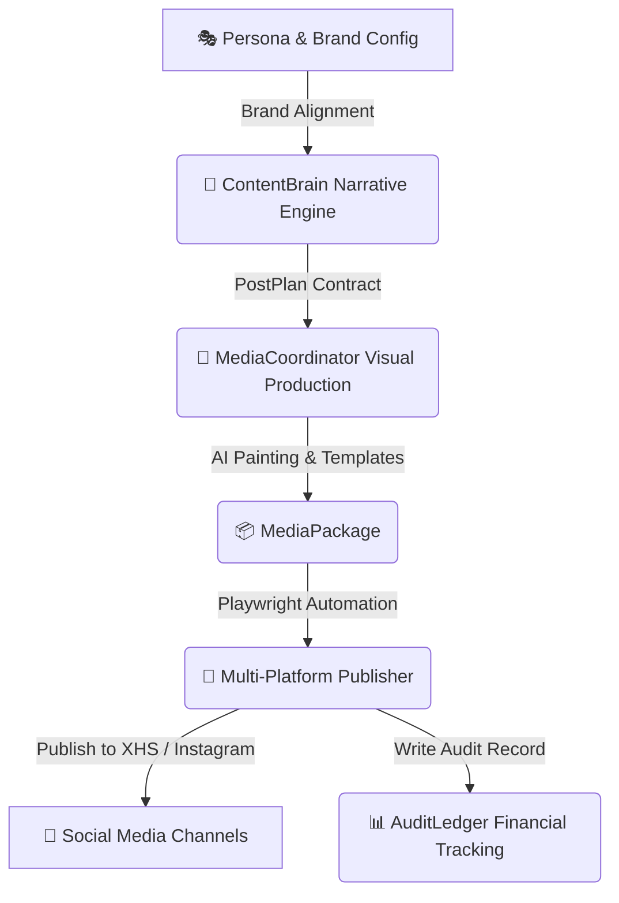

<div align="center">

```text
 ██████╗ ███████╗██████╗ ███████╗██████╗ ███╗   ██╗██████╗  ██████╗ ███████╗
 ██╔══██╗██╔════╝██╔══██╗██╔════╝██╔══██╗████╗  ██║██╔══██╗██╔═══██╗██╔════╝
 ██████╔╝█████╗  ██████╔╝███████╗██║  ██║██╔██╗ ██║██║  ██║██║   ██║███████╗
 ██╔═══╝ ██╔══╝  ██╔══██╗╚════██║██║  ██║██║╚██╗██║██║  ██║██║   ██║╚════██║
 ██║     ███████╗██║  ██║███████║╚██████╔╝██║ ╚████║██████╔╝╚██████╔╝███████║
 ╚═╝     ╚══════╝╚═╝  ╚═╝╚══════╝ ╚═════╝ ╚═╝  ╚═══╝╚═════╝  ╚═════╝ ╚══════╝
```

# PersonaOps — Industrial AI Persona Operating System

**Unified Autonomous AI Persona Operating Framework Built with Python, FastAPI, Streamlit, & Playwright**

[ 🇺🇸 **English** ](./README.md) • [ 🇨🇳 **中文文档** ](./README_CN.md)

---

[](https://opensource.org/licenses/MIT)
[](https://python.org)
[](https://fastapi.tiangolo.com)
[](https://playwright.dev)
[](https://openai.com)
[](https://github.com/tubban1/personaOps)

</div>

---

## 💡 What is PersonaOps?

`personaOps` is an industrial-grade, fully closed-loop AI persona operating system. It integrates persona planning, brand alignment, interaction sensing, high-fidelity media production, and multi-platform distribution into a unified autonomous execution engine.

---

## ⚡ Key Features

<table width="100%">
<tr>
<td width="50%" valign="top">

### 🎭 1. Persona & Brand Domain Modeling
* **Persona Sovereignty Contract**: Defines "who I am" and "who I serve".
* **ContentBrain Narrative Engine**: Automated generation of time-continuous `PostPlan`s.

</td>
<td width="50%" valign="top">

### 🧠 2. Interaction Sensing & Risk Control
* **Audience Intent Recognition**: Real-time sensing of comments, likes, and DMs.
* **Risk & Compliance Filter**: Automated sensitive word detection & safety alerts.

</td>
</tr>
<tr>
<td width="50%" valign="top">

### 🎨 3. High-Fidelity Media Pipeline
* **Dual Media Engine**: HTML/CSS template rendering combined with AI image generation (DALL-E 3).
* **`MediaPackage` Contract**: Lossless visual output tailored for social platforms.

</td>
<td width="50%" valign="top">

### 🚀 4. Multi-Platform Automated Driver
* **Playwright Driver**: Automated physical execution for Xiaohongshu (XHS) & Instagram.
* **Audit Domain**: Token cost & financial audit ledger tracking every action.

</td>
</tr>
</table>

---

## 🛠️ Architecture & Workflow



---

## 📁 Directory Structure

```
personaOps/
├── app/                 # ContentBrain, MediaCoordinator, Publisher, & Audit
├── data/entities/       # Persona & Brand JSON schema configs
├── docs/                # Architecture specification whitepapers
├── main.py              # CLI entry point
└── dashboard_main.py    # Streamlit/Dash operations dashboard
```

---

## ⚡ Quick Start

```bash
# 1. Install dependencies
pip install -r requirements.txt
playwright install chromium

# 2. Run default persona pipeline
python3 main.py
```

---

## 🤝 License

Released under the **MIT License**.
