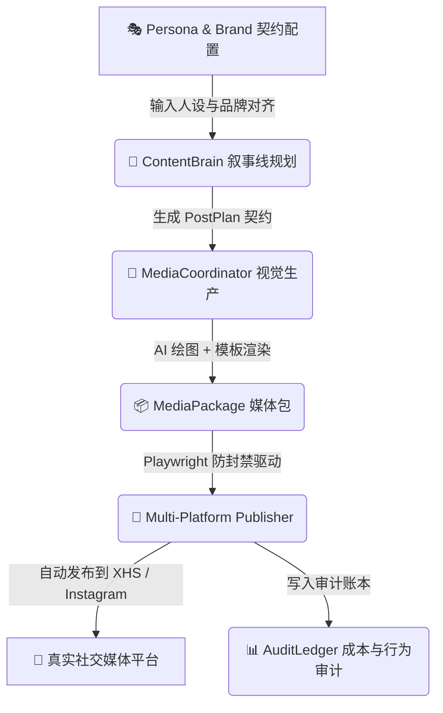

<div align="center">

```text
 ██████╗ ███████╗██████╗ ███████╗██████╗ ███╗   ██╗██████╗  ██████╗ ███████╗
 ██╔══██╗██╔════╝██╔══██╗██╔════╝██╔══██╗████╗  ██║██╔══██╗██╔═══██╗██╔════╝
 ██████╔╝█████╗  ██████╔╝███████╗██║  ██║██╔██╗ ██║██║  ██║██║   ██║███████╗
 ██╔═══╝ ██╔══╝  ██╔══██╗╚════██║██║  ██║██║╚██╗██║██║  ██║██║   ██║╚════██║
 ██║     ███████╗██║  ██║███████║╚██████╔╝██║ ╚████║██████╔╝╚██████╔╝███████║
 ╚═╝     ╚══════╝╚═╝  ╚═╝╚══════╝ ╚═════╝ ╚═╝  ╚═══╝╚═════╝  ╚═════╝ ╚══════╝
```

# PersonaOps — 工业级自治 AI 人设全流程运营系统

**基于 Python + FastAPI + Streamlit/Dash + Playwright 的 AI 虚拟人设、多平台内容生产与自动分发闭环框架**

[ 🇺🇸 **English** ](./README.md) • [ 🇨🇳 **中文文档** ](./README_CN.md)

---

[](https://opensource.org/licenses/MIT)
[](https://python.org)
[](https://fastapi.tiangolo.com)
[](https://playwright.dev)
[](https://openai.com)
[](https://github.com/tubban1/personaOps)

</div>

---

## 💡 什么是 PersonaOps？

**PersonaOps** 是一个工业级、全闭环的 AI 人设运营与自治数字人发布系统。它将人设规划、品牌对齐、交互感知、高保真媒体生产与多平台自动化分发整合为单项目自治单元，实现零人工干预的虚拟人全生命周期运营。

---

## ⚡ 核心架构特色

<table width="100%">
<tr>
<td width="50%" valign="top">

### 🎭 1. Persona & Brand 领域驱动建模
* **人设主权契约**：定义“我是谁”（性格、受众、人设基调）与“为谁服务”。
* **叙事线规划 (ContentBrain)**：自动化生成具备时间连续性的 `PostPlan`。

</td>
<td width="50%" valign="top">

### 🧠 2. 交互感知与风险管控 (InteractionBrain)
* **粉丝意图识别**：实时感知社交媒体平台点赞、评论与私信反馈。
* **风控与安全过滤器**：自动检测敏感词、合规风控与舆情预警。

</td>
</tr>
<tr>
<td width="50%" valign="top">

### 🎨 3. 高保真媒体生产 Pipeline (Media Domain)
* **双图文合成引擎**：整合 HTML/CSS Template 渲染与 AI Image (DALL-E 3 / VectorEngine) 图文卡片。
* **`MediaPackage` 契约交付**：零失真输出符合各平台最佳尺寸的视觉包。

</td>
<td width="50%" valign="top">

### 🚀 4. 多平台安全驱动与审计 (Publish & Audit)
* **Playwright 防封禁无痕发布**：支持小红书 (XHS)、Instagram 物理执行。
* **全链路 Token 与成本审计**：记录从“一个念头”到“一次发布”的每一分钱支出。

</td>
</tr>
</table>

---

## 🛠️ 架构与 Workflow 流程图



---

## 🛠️ 固化标准化生产工具链 (CLI Tools)

| 工具脚本 | 命令 | 功能描述 |
| :--- | :--- | :--- |
| **默认演示运行** | `python3 main.py` | 运行默认人设 (林小棠 @ 小红书) 自动化流水线 |
| **自定义人设发布** | `python3 main.py --persona <path> --brand <path>` | 指定其他人设 JSON 与品牌配置运行 |
| **一键平台覆盖** | `python3 main.py --platform instagram --account acc_01` | 强行覆盖发布平台与账号 ID |
| **交互控制台启动** | `python3 dashboard_main.py` | 启动 Streamlit / Dash 可视化运营看板 |
| **自动化测试套件** | `pytest` | 运行人设契约与多平台驱动单元测试 |

---

## 📁 目录结构

```
personaOps/
├── app/
│   ├── core/            # ContentBrain, InteractionBrain 核心大脑
│   ├── media/           # MediaCoordinator 媒体渲染与 AI 画图引擎
│   ├── publisher/       # Playwright 多平台自动化发布驱动 (XHS, Instagram)
│   └── audit/           # AuditLedger 成本与审计账本
├── data/
│   └── entities/        # Persona 人设与 Brand 品牌 Schema 配置
├── docs/                # PersonaOps 架构白皮书与规范文档
├── main.py              # CLI 入口与调度主程序
├── dashboard_main.py    # 可视化运营 dashboard 界面
└── requirements.txt     # Python 依赖规范
```

---

## ⚡ 快速开始

### 1. 安装依赖

```bash
pip install -r requirements.txt
playwright install chromium
```

### 2. 配置环境变量
在 `data/.env` 中配置您的大模型与绘图 API 凭证：

```ini
VECTORENGINE_API_KEY=your_key
VECTORENGINE_URL=https://api.example.com/v1
VECTORENGINE_IMAGE_MODEL=dall-e-3
```

### 3. 启动运营主程序

```bash
python3 main.py
```

---

## 🤝 开源协议 (License)

本项目基于 **MIT License** 开源。

<div align="center">
  <sub>Owl Lab PersonaOps 工程团队精心打造。基于 Python, FastAPI, Playwright 与 OpenAI 构建。</sub>
</div>
